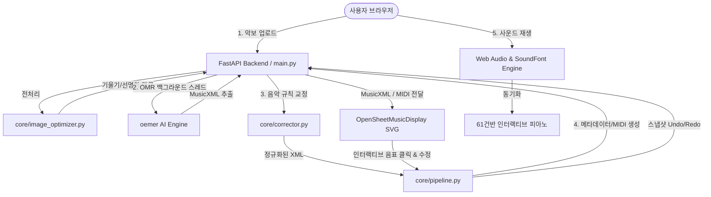

# 🎹 AI-STEAM v2.0 | Interactive AI Sheet Music Editor & OMR Studio

> **AI 기반 악보 인식(OMR), 실시간 오차 교정, 양손 피아노 연주 및 Web Audio 사운드 재생 스튜디오**

[](https://fastapi.tiangolo.com)
[](https://python.org)
[](https://web.mit.edu/music21/)
[](https://github.com/BreezeWhite/oemer)
[](https://opensheetmusicdisplay.org/)
[](https://opensource.org/licenses/MIT)

---

## 🌟 주요 기능 (Key Features)

### 1. ⚡ 하이브리드 파이프라인 (원클릭 자동 vs 단계별 디버그)
- **원클릭 자동 진행 (`ON`)**: 악보 이미지 또는 PDF 파일을 드롭존에 업로드하는 즉시 `전처리 → OMR 추출 폴링 → 음악 규칙 자동 최적화 → 악보 렌더링`까지 비동기 체인으로 한 번에 자동 실행됩니다.
- **단계별 디버그 (`OFF`)**: 개발 및 정밀 검증 시 각 단계([1] 전처리, [2] OMR, [3] 교정, [4] 렌더링)를 버튼으로 개별 제어할 수 있습니다.

### 2. 🧠 AI 악보 인식 (OMR) & 이미지 전처리
- **OpenCV 기반 적응형 전처리**: 오선지 기울기 자동 감지 및 회전(Deskew), CLAHE 대비 강화, 해상도 정규화(1800px), 언샤프 마스킹 선명화.
- **oemer AI 엔진**: 심볼, 음표머리, 보표를 딥러닝으로 추출하며 실시간 콘솔 로그 및 진행률 표시(백그라운드 비동기 잡 및 취소 기능 완비).
- **Windows 인코딩 오류 방지**: Windows 환경에서 빈번한 `cp949` 코덱 충돌을 완벽 차단하는 UTF-8 스트림 재구성 적용.

### 3. ✨ 1차 음악 규칙 자동 교정 (Score Corrector)
- OMR 인식 결과물에 대해 음악 이론 규칙을 적용하여 자동 정규화:
  - 88건반(A0~C8) 범위 초과 피치 안전 클램핑
  - 2048th, 1024th 등의 극소 노이즈 파편 음표 자동 제거
  - 동일 오프셋 중복 피치 제거
  - 높은음자리표(Treble) / 낮은음자리표(Bass) 기본값 검증 및 마디 구조(`makeMeasures`/`makeTies`) 보정

### 4. 🎼 정밀 인터랙티브 악보 에디터 (양손 대보표 지원)
- **정밀 타겟팅**: 단순 인덱스가 아닌 `마디 번호(measure) + 보표 선택(part_index) + 마디 내 박자 위치(offset)`를 기준으로 음표 특정.
- **보표 스위칭**: `[편집 대상: 🎼 오른손(주선율) | 🎹 왼손(반주)]` 간편 토글.
- **피치 및 박자 도구**: 반음 `↑`/`↓`, 옥타브 `▲`/`▼`, 임시표(`♯`, `♭`, `♮`), 음길이(`1/1` ~ `1/16`, 점음표), 쉼표(`REST`) 변환 및 삭제.
- **화음 쌓기 (Chord Add)**: <kbd>Shift</kbd> 키를 누른 채 건반 또는 알파벳을 입력하여 기존 음표에 화음 추가.
- **스냅샷 히스토리**: 최대 20단계의 <kbd>Ctrl+Z</kbd>(Undo) / <kbd>Ctrl+Y</kbd>(Redo) 즉시 지원.

### 5. 🎹 Web Audio & Acoustic Grand SoundFont 재생 엔진
- Web Audio API와 Acoustic Grand Piano SoundFont 연동 (오프라인 시 정밀 오실레이터 폴백).
- `audioCtx.currentTime` 기반 절대 시간 스케줄러로 BPM(40~200) 변경 시에도 흔들림 없는 일정한 박자 연주.
- 연주 중 OSMD 커서 이동에 맞춘 부드러운 화면 자동 스크롤(Auto-scroll).
- 61건반(C2~C7) 가상 피아노 롤 실시간 타건 조명 동기화.

---

## 🏗️ 아키텍처 (Architecture)



---

## 📁 프로젝트 파일 구조

```text
├── core/
│   ├── __init__.py
│   ├── image_optimizer.py      # OpenCV 기울기 보정(Deskew), CLAHE, 선명화
│   ├── corrector.py            # OMR 규칙 1차 자동 교정 (88건반, 파편, 중복 제거)
│   └── pipeline.py             # 비동기 잡/취소, 정밀 오프셋 수동 편집, Undo/Redo
├── static/
│   ├── default.musicxml        # 오른손(P1) & 왼손(P2) 4마디 대보표 피아노 데모 악보
│   ├── index.html              # 다크/라이트 테마, 파이프라인 3열 카드, 에디터 UI
│   ├── style.css               # 모던 글래스모피즘 CSS 디자인 시스템
│   └── app.js                  # OSMD 렌더링, Web Audio 재생, 에디터 상태 머신
├── main.py                     # FastAPI REST API 엔드포인트 & 정적 파일 서빙
├── requirements.txt            # Python 필수 의존성 패키지 목록
└── .gitignore                  # Git 추적 제외 설정
```

---

## 🚀 빠른 시작 가이드 (Quick Start)

### 1. 저장소 복제 및 가상환경 설정
```bash
git clone https://github.com/yjchoi101222/ai-sheet-music-editor.git
cd ai-sheet-music-editor

# 가상환경 생성 및 활성화 (Windows 기준)
python -m venv venv
venv\Scripts\activate

# 의존성 패키지 설치
pip install -r requirements.txt
```

### 2. 로컬 개발 서버 실행
```bash
python -m uvicorn main:app --host 127.0.0.1 --port 8000 --reload
```

### 3. 브라우저 접속
웹 브라우저를 열고 다음 주소로 접속합니다:
👉 **[http://127.0.0.1:8000](http://127.0.0.1:8000)**

- 우측 상단 **[🎵 데모 악보 불러오기]** 버튼을 누르면 즉시 양손 피아노 4마디 악보가 렌더링됩니다.
- 상단 **[▶ 재생]** 버튼 또는 <kbd>Space</kbd> 키를 누르면 고품질 피아노 사운드 재생을 청취할 수 있습니다.

---

## ⌨️ 단축키 안내 (Keyboard Shortcuts)

| 기능 | 단축키 | 설명 |
| :--- | :--- | :--- |
| **재생 / 일시정지** | <kbd>Space</kbd> | 실시간 오디오 재생 및 정지 토글 |
| **피치 직접 입력** | <kbd>C</kbd> ~ <kbd>B</kbd> | 선택된 음표의 음이름 즉시 변경 |
| **화음 쌓기 (Chord)** | <kbd>Shift</kbd> + 건반/단축키 | 커서 전진 없이 기존 음표에 새 음정 추가 |
| **반음 올림 / 내림** | <kbd>↑</kbd> / <kbd>↓</kbd> | 반음 단위 실시간 조 옮김 |
| **옥타브 이동** | <kbd>PageUp</kbd> / <kbd>PageDown</kbd> | 12반음(1옥타브) 단위 이동 |
| **음길이 변경** | <kbd>1</kbd>, <kbd>2</kbd>, <kbd>4</kbd>, <kbd>8</kbd>, <kbd>6</kbd> | 온음표(4.0) ~ 16분음표(0.25) 즉시 선택 |
| **쉼표 변환 / 삭제** | <kbd>Delete</kbd> / <kbd>Backspace</kbd> | 현재 음표를 마디 구조를 유지하며 쉼표로 치환 |
| **실행 취소 / 재실행** | <kbd>Ctrl+Z</kbd> / <kbd>Ctrl+Y</kbd> | 최대 20단계 XML 스냅샷 복원 |
| **음표 이동** | <kbd>→</kbd> / <kbd>←</kbd> | 다음 / 이전 음표로 커서 이동 |

---

## 📜 라이선스 (License)
이 프로젝트는 [MIT License](LICENSE)에 따라 자유롭게 사용 및 수정할 수 있습니다.
